# Hands-on: a CSOC in AWS with Terraform, then Gen3 commons on it

CSOC Working Group, Wednesday October 28, 2026, 3–4pm CT.

In this session you take an empty AWS account to a running CSOC (the Gen3
control plane), then deploy Gen3 commons from it: first into the CSOC's own
cluster, then into a separate cluster in another AWS account, joined to the
CSOC over VPC peering.

Everything happens in the browser, in the bootstrap wizard that runs on your
laptop. You do not create buckets, DNS zones or clusters by hand: the wizard
does it, and shows you what it is about to do first.

> This guide was written by doing every step from a blank account. Times are
> what each step took then.

## The parts

| Piece | Where it runs | What it does |
|---|---|---|
| Bootstrap wizard | your laptop, `localhost:3000` | walks you through the setup, from a blank account |
| Bootstrap API | your laptop, `127.0.0.1:8002` | uses your AWS credentials; never reachable from the network |
| Terraform runner | a container started per run | runs `terraform init/plan/apply` and the install scripts |
| Terraform state | S3, in your account | one bucket, locked with an S3 lock file (no DynamoDB) |
| CSOC | EKS, in your account | the portal and Keycloak, reached at `portal.<your zone>` |

## Before the workshop

- **Docker**, running. Docker Desktop, OrbStack or Colima all work.
- **This repository**, checked out:
  `git clone https://github.com/uc-cdis/gen3-admin && cd gen3-admin`
- **An AWS account you can admin**, and a profile for it in `~/.aws/config`.
  SSO profiles work. If you reach the account by assuming a role, a profile
  like this one does it:

  ```ini
  [profile csoc-workshop]
  role_arn = arn:aws:iam::<account id>:role/<admin role>
  source_profile = default
  region = us-east-1
  ```

  Check it: `aws sts get-caller-identity --profile csoc-workshop`.
- **A domain you control**, to delegate a subdomain of. In this guide that is
  `planx-pla.net`, and the CSOC gets `workshop.planx-pla.net`. If the parent
  zone is in Route53 and one of your profiles can reach it, the wizard adds
  the delegation for you; otherwise it shows the four NS records to add
  wherever your domain is hosted.

Cost: the CSOC (VPC, NAT gateway, EKS and its nodes) is about $300–400 a
month while it runs. Teardown is at the end of this guide.

## Part 1: the CSOC

### Step 1. Start the wizard (about 1 minute with images pulled)

```bash
docker compose -f docker-compose-bootstrap-csoc.yml up -d
open http://localhost:3000/bootstrap
```

This starts three containers: the **API** (bound to `127.0.0.1:8002` only),
the **frontend** (`localhost:3000`), and a **Docker socket proxy** that lets
the API start Terraform runner containers and nothing else. The API runs
without login, as an admin that can use your AWS credentials, which is why
none of it listens on your network.

> Developers, building from a checkout: run `./scripts/build-terraform-image.sh`
> first, and add `--build` to the `up`. To test unpublished gen3-terraform
> modules, set `TERRAFORM_MODULES_DIR=~/path/to/gen3-terraform`.

The wizard opens on **Welcome**: what will be built, and how the pieces
relate. Click **Next**.

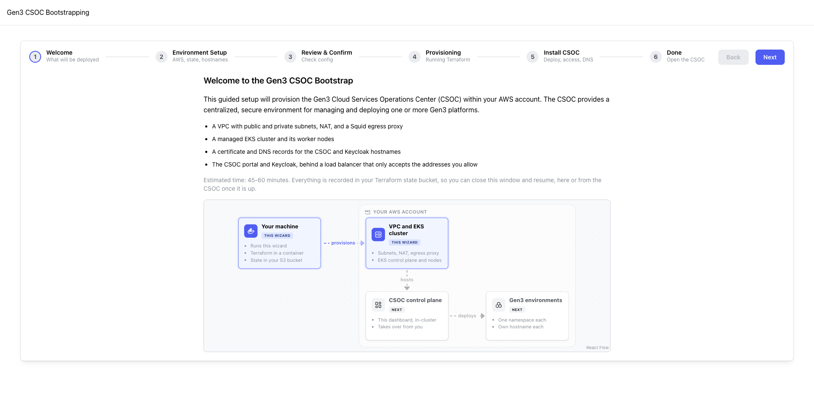

### Step 2. Pick the account (and check it)

**Environment setup** starts with your AWS credentials. *Auto-detect* uses
your default credentials, and the blue box says which account and role that
is.

**Read the account number before going on.** In our run, auto-detect found
the account that holds the parent DNS zone, not the workshop account. Choose
**Select AWS profile** and pick the profile for the account you are deploying
into (here `csoc-workshop`). The box should now show that account, and the
role you reach it through.

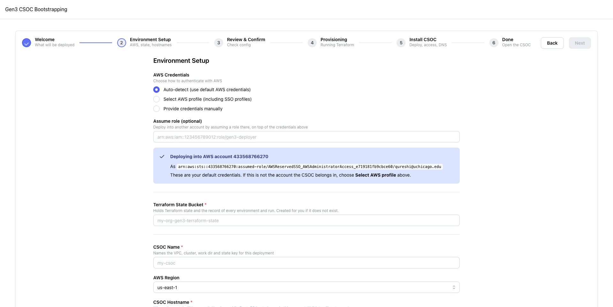

### Step 3. The state bucket

Type a bucket name, for example `gen3-csoc-<name>-<account id>` (bucket names
are global), and click **Check**. Wait for the identity box to update before
you do.

The bucket does not exist yet, so the wizard offers to create it: versioned,
encrypted, TLS-only and blocked from public access. Click **Create bucket**.

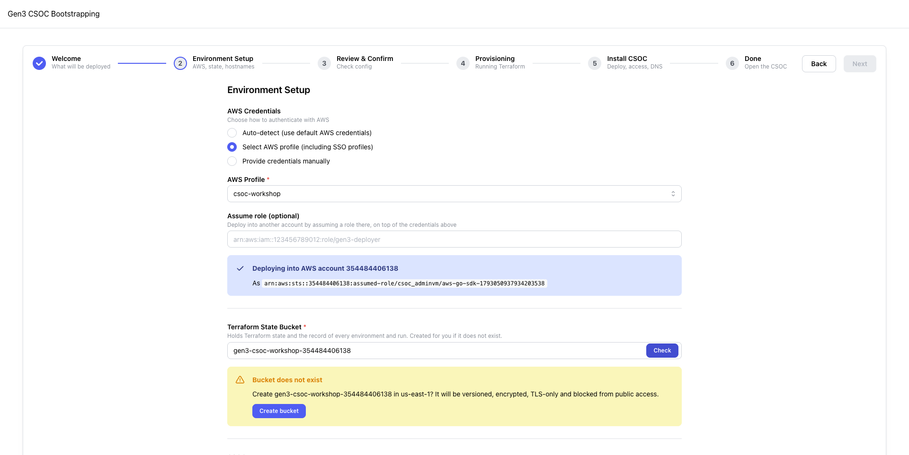

This bucket holds the Terraform state, locked with an S3 lock file (no
DynamoDB table), and the CSOC's record of every environment and run.

### Step 4. Name, hostname and DNS zone

- **CSOC name**: `workshop`. It names the VPC, the cluster and the state key.
- **CSOC hostname**: `portal.workshop.planx-pla.net`. Click **Validate**.

There is no hosted zone for it yet, so the wizard offers to create
`workshop.planx-pla.net` in the account you are deploying into. The portal,
Keycloak, and later the commons all get names under it.

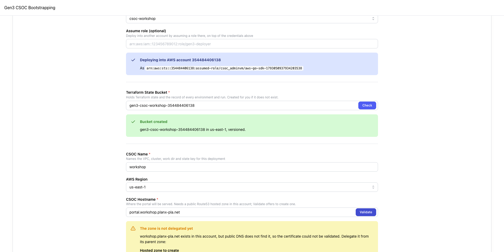

The zone has to be delegated from its parent, `planx-pla.net`, which in our
case is in a different account. Under **Delegate it from the parent zone
using**, choose the profile that reaches the parent (here `default`). If your
domain is not in Route53, choose **I'll add the NS records myself**, and the
wizard shows the four NS records to add at your DNS host.

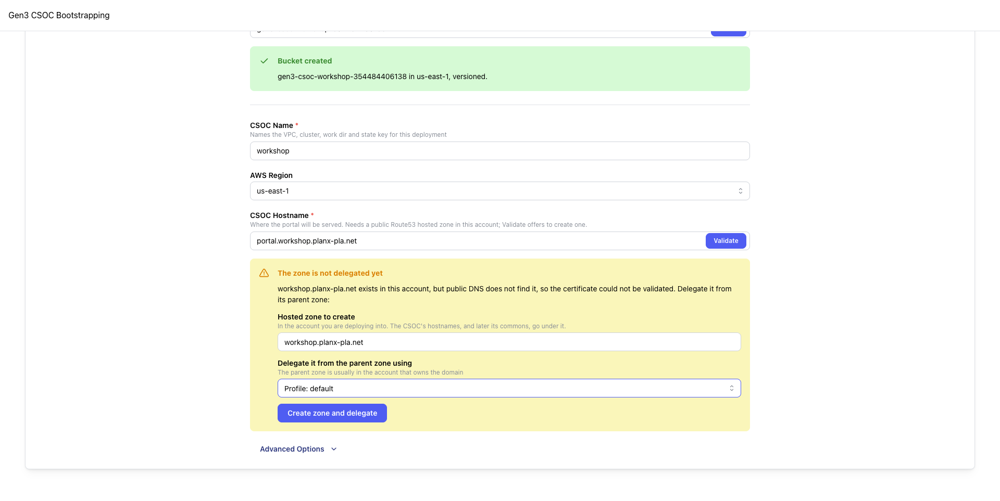

Click **Set up zone and delegation**. The wizard creates the zone, adds the NS
record in the parent, and refuses if the parent already has records for that
name. It then waits for public DNS to see the delegation, because the TLS
certificate cannot be validated before that. Click **Check again** until it
says **Domain Verified**. For us that was immediate; allow a few minutes.

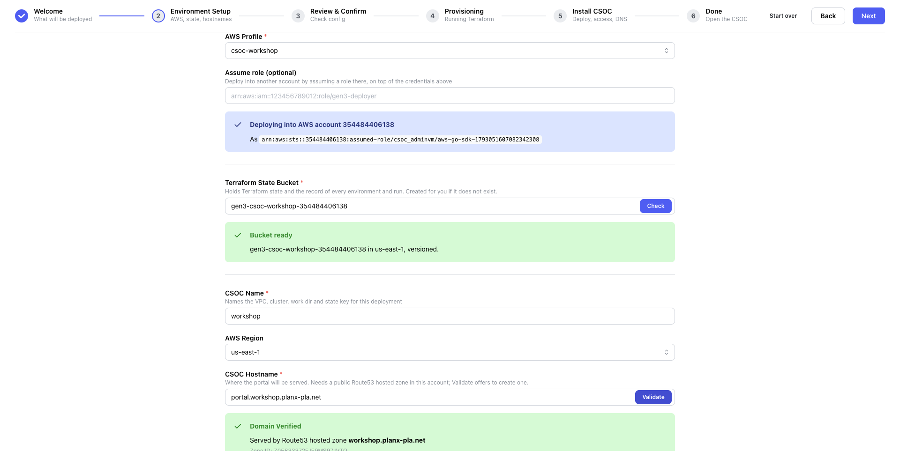

**Advanced options** has the Keycloak hostname (`auth.workshop.planx-pla.net`
by default), an existing ACM certificate if you have one, and the VPC CIDR
(`172.24.16.0/20`). Remember the CIDR: the commons VPC you peer with later
must not overlap it. Click **Next**.

### Step 5. Review

**Review & confirm** lists the account, hostnames, state location, what is
built, and a rough monthly cost (about $340). Nothing has been created in
AWS except the bucket and the DNS zone. Click **Provision**.

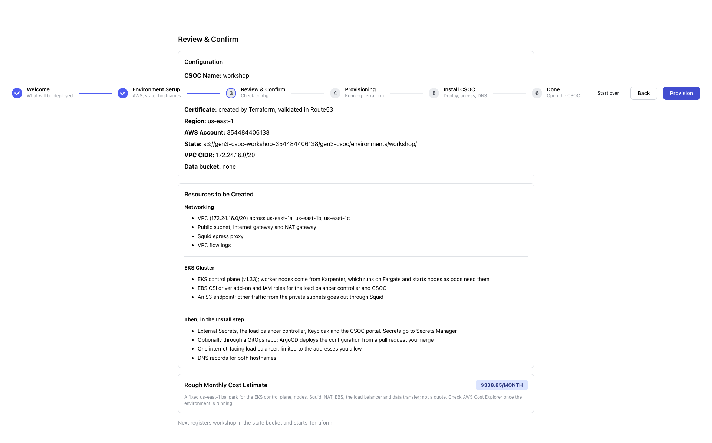

### Step 6. Init and plan (under a minute each)

Provision registers the environment in the state bucket and starts
`terraform init` in a runner container: it downloads the providers and the
gen3-terraform modules, and connects to the S3 backend.

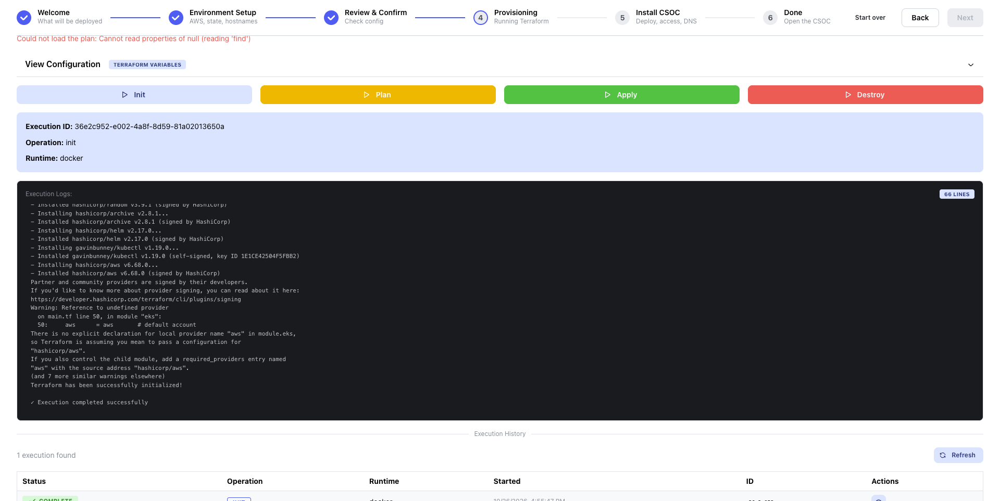

When it finishes, click **Plan**. Terraform works out what it would create,
and changes nothing. We got **133 to add, 0 to change, 0 to destroy**.

The **Plan review** groups the changes: networking, firewall rules, the
cluster, IAM, DNS and certificate, storage, logging.

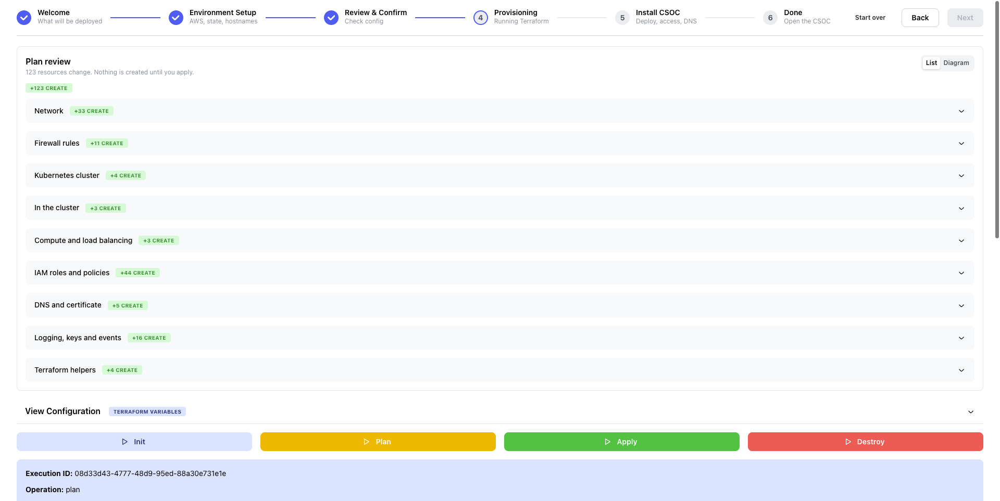

**Diagram** draws the same plan: the VPC, its availability zones and
subnets, and what runs in them, with the account-wide services (IAM, KMS,
Route53, S3) in blocks you can open. Settings such as policy attachments are
folded into the resource they configure (the `+N` on a card).

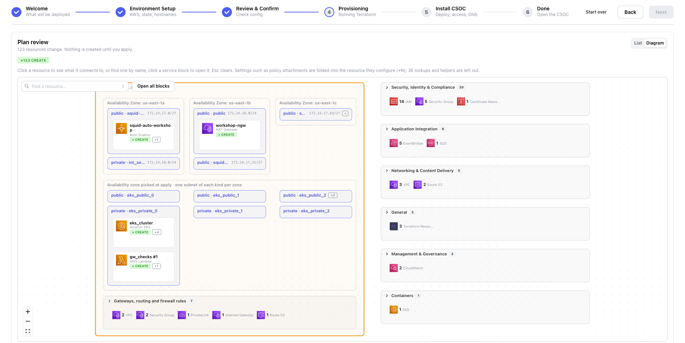

The EKS subnets sit in a band of their own, "availability zone picked at
apply": the module shuffles the zones at apply time, so the plan cannot know
which subnet lands where, only that there is one of each kind per zone.

Things to try:

- **Find a resource** by name: `nat`, `eks clus`, `csoc api`. The diagram
  zooms to it, opening its block if it is folded away.

  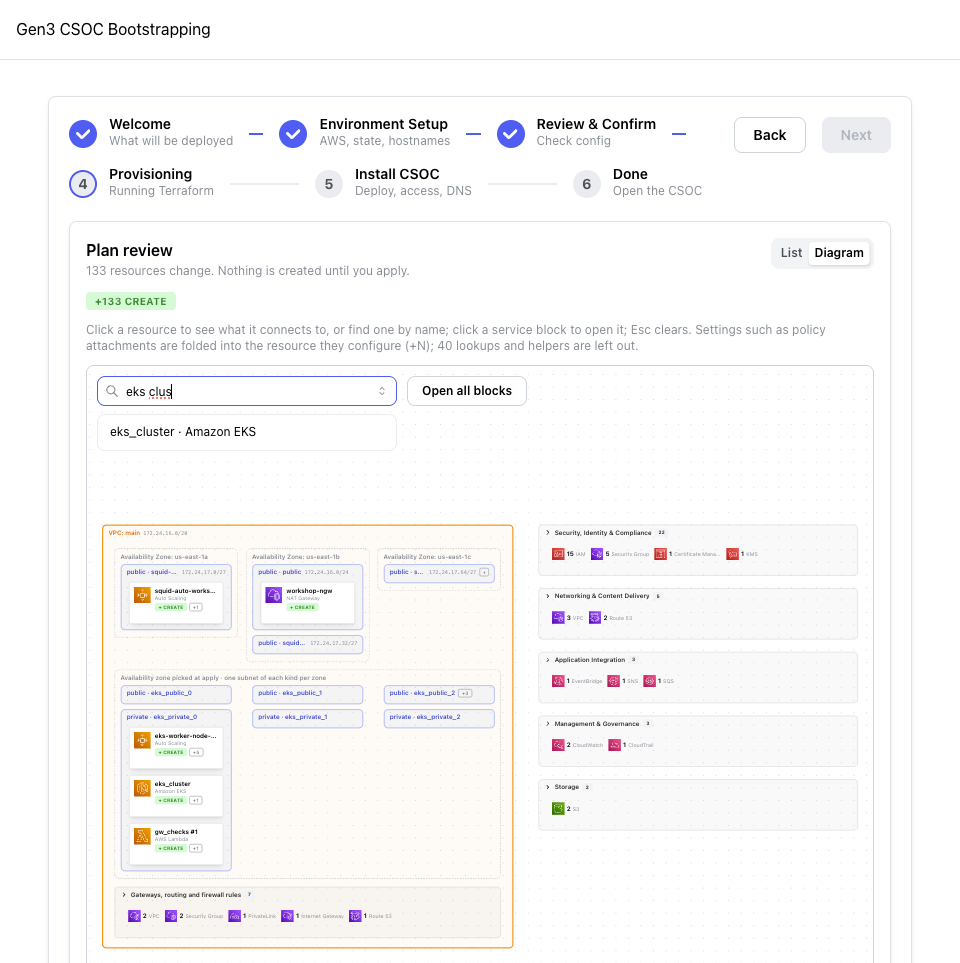

- **Click a resource.** Its connections are drawn and named (NAT, Route, IAM
  Role, DNS, Secured By), everything else dims, and the details open beside
  the diagram: the Terraform address, what configures it, and what it
  connects to. Click a name there to jump to it. **Esc** clears.

  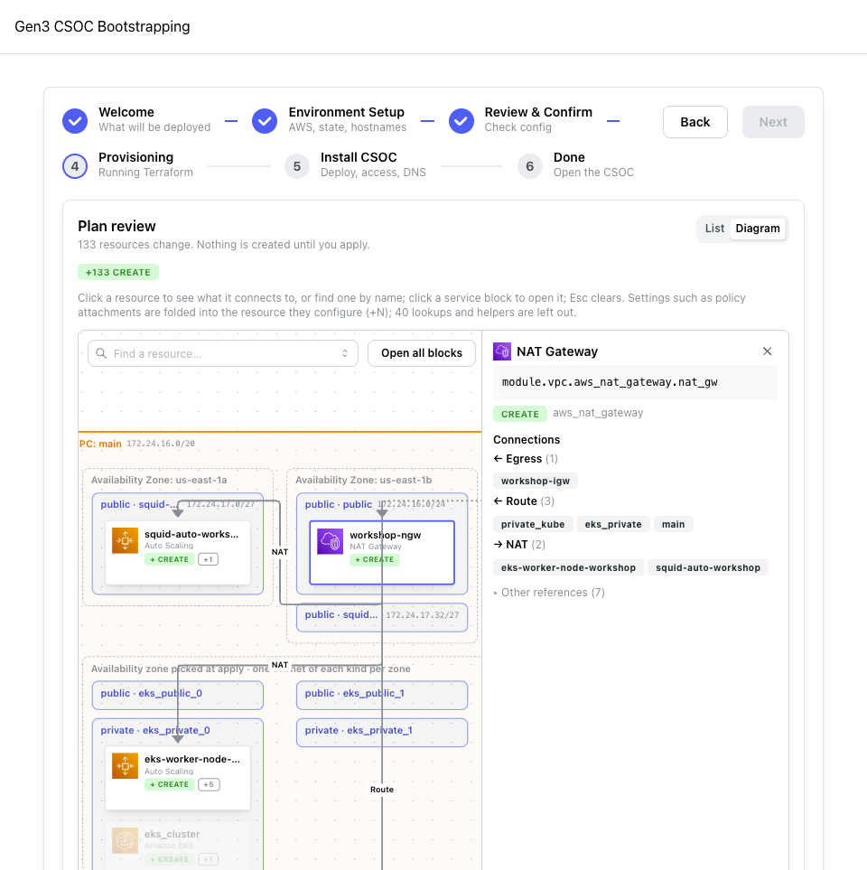

- **Click a service block** to open it, or **Open all blocks**. Security,
  Identity & Compliance holds the IAM roles (one per controller: load
  balancer, external secrets, EBS CSI, the CSOC API), security groups, the
  KMS key and the certificate.

  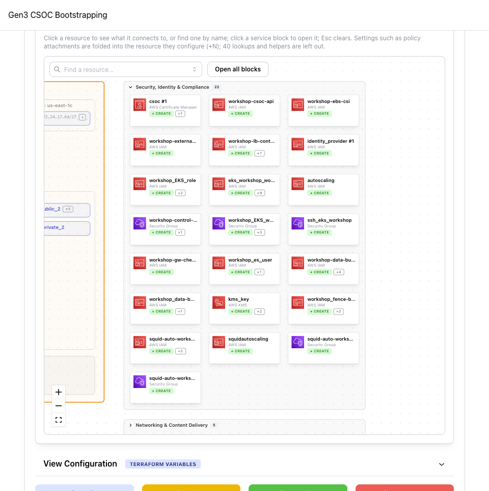

Only a summary of the plan reaches the browser: addresses, types, actions and
names. The full plan holds your variable values and never leaves the runner.

> **Closed the tab?** Nothing is lost. Open `/bootstrap` again, pick the same
> profile and bucket, and click **Check**: the bucket lists its environments.
> Click **Resume** on yours, then **Provision** (it re-runs `init`, which
> changes nothing) and carry on.
>
> 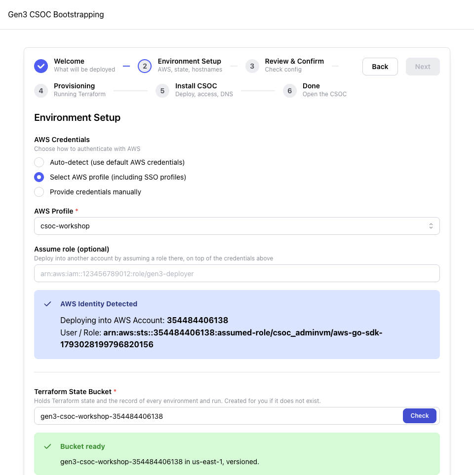

### Step 7. Apply (about 20–25 minutes)

Click **Apply**. It applies the plan you just reviewed, nothing else. While
it runs, the plan review turns into progress: every resource shows waiting,
in progress (with how long), done or failed, in the list and on the diagram,
and a bar shows the whole.

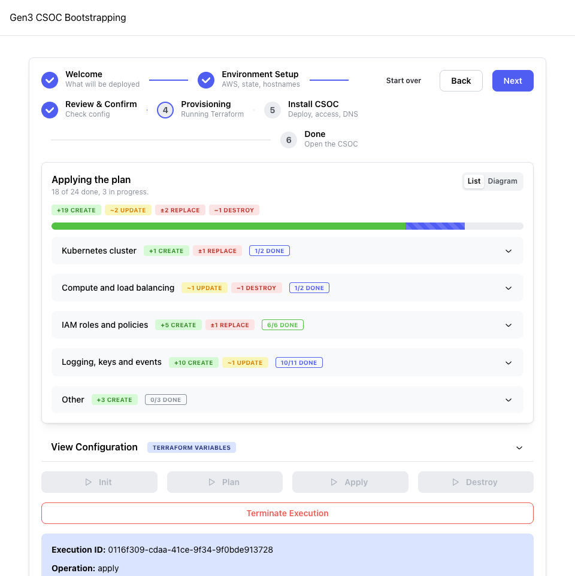

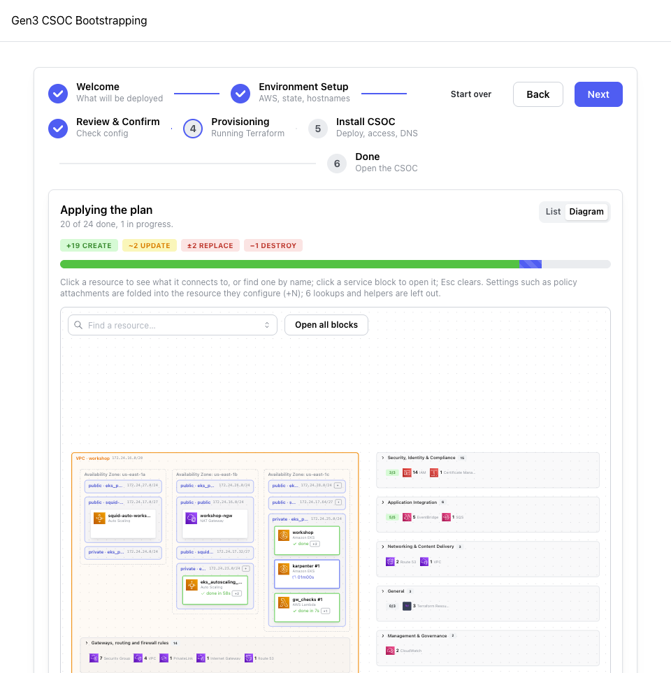

What takes the time, in order: the VPC, NAT gateway and Squid (a few
minutes); the EKS control plane (about 10); then the cluster's own pieces:

- **Squid takes over egress.** The private subnets have no route to the
  internet of their own. A small Lambda (gw_checks), in a subnet that goes
  out through the NAT gateway, finds a healthy Squid and points the private
  subnets' default route at it, and names it `cloud-proxy.internal.io`.
  From then on everything the cluster fetches goes through Squid's
  allowlist.
- **Karpenter starts nodes.** Its controller runs on Fargate, so it needs no
  nodes itself. Once its image is pulled (through Squid), it sees pods with
  nowhere to run and starts EC2 nodes for them, Amazon Linux 2023. There are
  no fixed worker nodes.
- **The EBS CSI driver** comes up on those nodes, which is what Terraform
  waits for last.

> **Closed the tab, or it reloaded?** Open `/bootstrap` again: the wizard
> returns to the step you were on and follows a run that is still going. It
> never starts a second one beside it.
>
> 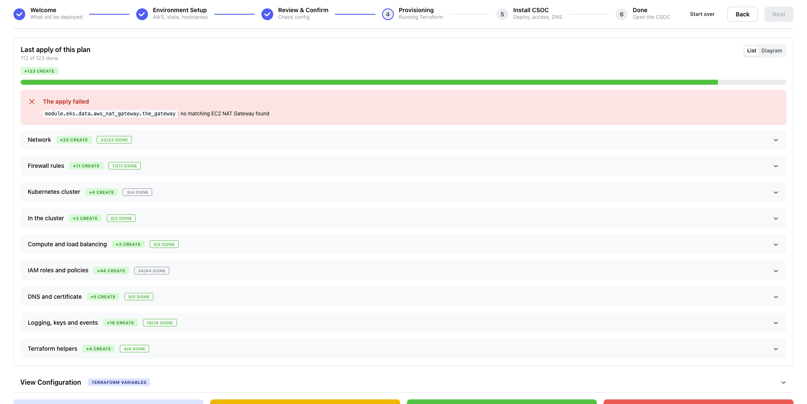

> **If an apply fails**, the list says which resource and why. Terraform keeps
> what it created, so you fix the cause, then **Init**, **Plan** and
> **Apply** again; the new plan shows only what is left.

### Step 8. Install the CSOC (about 5 minutes)

Click **Next** to **Install CSOC**.

- **How to deploy:** *Directly, from this wizard*. Helm installs the same
  configuration ArgoCD would, with no Git repo. (GitOps is the other option;
  it needs a GitHub App and a repo.)
- **Allowed addresses:** only these can reach the portal and Keycloak. Your
  current IP is filled in. Add your team's or VPN's ranges.
- **Admin password:** click **Generate password** and save it. It is for the
  CSOC user `admin`, goes to the cluster once, and is not stored anywhere
  else. Give an **admin email** too, or Keycloak asks for one at first login.

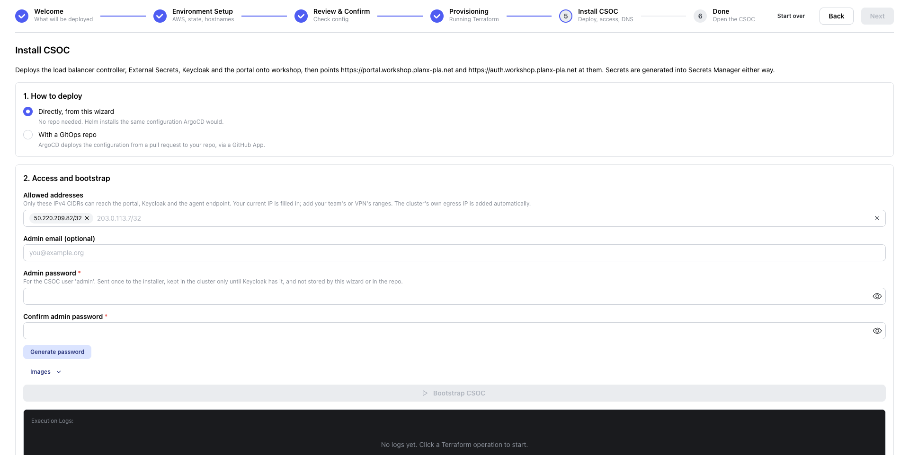

Click **Bootstrap CSOC**. In a few minutes it:

1. Creates the CSOC's secrets in AWS Secrets Manager (`gen3-csoc/<name>/`).
2. Finds the cluster's egress IP (Squid's public address), which is added to
   the allowlist: the portal calls Keycloak at its public hostname.
3. Installs External Secrets (which copies those secrets into the cluster),
   the AWS Load Balancer Controller, CloudNativePG (Keycloak's database),
   the Keycloak operator, Keycloak and its realm, and the CSOC portal.

### Step 9. Finish (about 5 minutes)

Click **Finish install**. It applies the allowlist (your addresses and the
egress IP), waits for Keycloak and the portal, imports the realm and then
deletes the first admin password from the cluster, and points both
hostnames at the load balancer.

```
=== CSOC is installed ===
Portal:   https://portal.workshop.planx-pla.net  (user: admin)
Keycloak: https://auth.workshop.planx-pla.net
```

### Step 10. Sign in

Open the portal. It sends you to Keycloak; sign in as `admin` with the
password you saved.

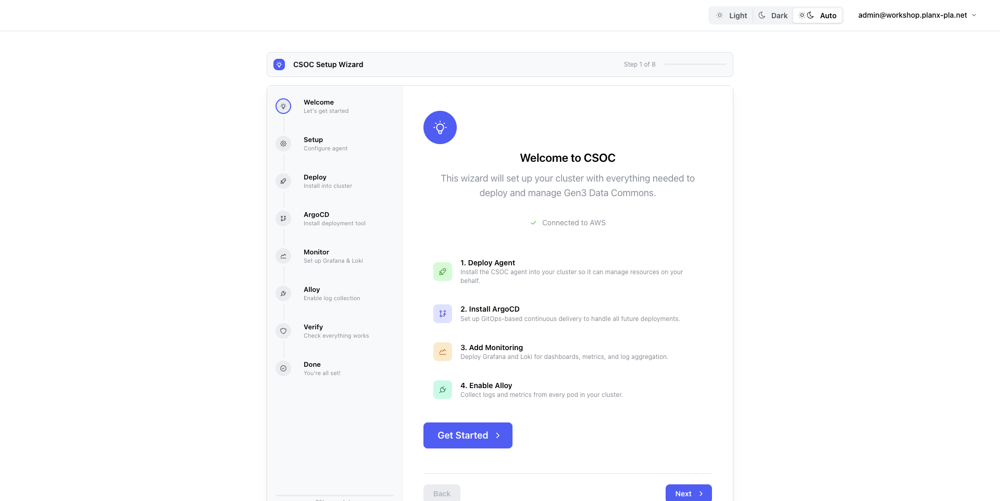

"Connected to AWS" means the portal is using its own IAM role (IRSA) in your
account. From here on, the CSOC is what you manage Gen3 with.

### Step 11. Tear down (afterwards, 25–30 minutes)

On **Done** (or from the banner on any step), **Tear down** opens the
teardown panel. It runs, in order, each step only once the one before it
succeeded:

1. **Uninstall the CSOC**: the load balancers, volumes, Karpenter nodes,
   DNS records and secrets the install added outside Terraform. Leave
   **Force** ticked for a workshop environment: it terminates the nodes
   rather than draining them.
2. **Destroy the infrastructure**: `terraform destroy`. Most of the time is
   AWS releasing the Squid lambda's network interface.
3. Optionally **delete the hosted zone** and its NS records in the parent
   zone (pick the profile that reaches the parent, as in Step 4).
4. Optionally **empty and delete the state bucket**, which takes the
   registry with it: back to a blank account.

Type the environment name and press **Tear down**. If a step fails, the
panel stops there with its log, and the banner offers the retry.

